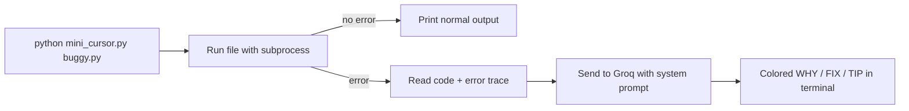

# Mini Cursor: Terminal AI Debugger

> Stop copy-pasting errors into ChatGPT. Run your Python file through Mini Cursor and get a plain-English fix right in your terminal.

Mini Cursor is a tiny command-line tool (about 30 lines of Python) that runs your script, catches the error, sends your code and the error trace to an LLM through the **free Groq API**, and prints a color-coded explanation and fix.

It is built to be read and understood: every line in `mini_cursor.py` has a comment explaining **what it does** and **why it is there**.

<!-- Add your demo GIF here -->
<!--  -->

## What it does

1. You run `python mini_cursor.py your_file.py`
2. The tool runs your file and captures the error
3. It sends your code and the error, plus a system prompt, to Groq (Llama 3.3)
4. You get the answer in three colored parts right in the terminal:
   - **WHY** (yellow): why the error happened
   - **FIX** (green): the corrected line or code
   - **TIP** (cyan): how to avoid it next time

## How it works



## Setup

**Requirements:** Python 3.8+ and a free Groq API key from [console.groq.com/keys](https://console.groq.com/keys).

```bash
# 1. Clone the repo
git clone https://github.com/YOUR_GITHUB_USERNAME/mini-cursor-ai-debugger.git
cd mini-cursor-ai-debugger

# 2. Install the dependency
pip install -r requirements.txt
```

**3. Set your API key** (the tool reads it from the `GROQ_API_KEY` environment variable):

| OS | Command |
|---|---|
| Windows (permanent, reopen the terminal after) | `setx GROQ_API_KEY "gsk_your_key_here"` |
| Windows PowerShell (this session only) | `$env:GROQ_API_KEY="gsk_your_key_here"` |
| macOS / Linux | `export GROQ_API_KEY="gsk_your_key_here"` |

> Never hard-code your key in the script and never commit it to GitHub.

## Usage

```bash
python mini_cursor.py buggy.py
```

Two demo files with intentional bugs are included:

| File | Bug |
|---|---|
| `buggy.py` | A number written as a string (`"92"`) breaks the sum (`TypeError`) |

### Sample output

The exact wording will vary from run to run, since it comes from an LLM.

```text
Error mila:
TypeError: unsupported operand type(s) for +: 'int' and 'str'

Mini Cursor soch raha hai...

WHY: One of the marks is written as "92" (text), so Python cannot add it to a number.
FIX: total = total + int(m)
TIP: Keep numbers as numbers. Convert text with int() before doing math.
```

## Project structure

```text
mini-cursor-ai-debugger/
├── mini_cursor.py     # the tool (every line commented)
├── buggy.py           # demo file 1 (TypeError)      
└── README.md
```

## Tech stack

- Python (`subprocess`, `sys`, `os`)
- [Groq API](https://console.groq.com) with `llama-3.3-70b-versatile`
- ANSI escape codes for terminal colors (no extra library)

## Customize

- **Change the model:** edit the `MODEL` line in `mini_cursor.py`. Groq's model list changes over time, so check [console.groq.com/docs/models](https://console.groq.com/docs/models) if a model stops working.
- **Change the style of answers:** edit `SYSTEM_PROMPT`. This is the "brain" of the tool.

## Limitations

- Works with Python files only
- Shows the fix but does not apply it automatically
- Your code and error are sent to the Groq API, so do not run it on files containing secrets
- The free tier has rate limits, so you may need to wait a few seconds between runs

## Ideas to extend it

- [ ] Auto-apply the fix to the file (with a confirm prompt)
- [ ] Support JavaScript, Java and C++ files
- [ ] Watch mode: re-run and re-check on every file save
- [ ] Save past errors and fixes as a personal "mistake diary"
- [ ] Add a flag like `--eli5` for even simpler explanations

## Watch the build

Full step-by-step video with line-by-line explanation: **[YouTube link here]**

## Author

**Nilesh**: AI Engineer from Kolhapur, Maharashtra. I build and test AI projects on my own laptop and share what actually works on **Nilesh Labs**.

- YouTube: [@nileshlabs](https://www.youtube.com/@nileshlabs)
- Instagram: [@nilesh.labs](https://www.instagram.com/nilesh.labs)

If this helped you, give the repo a star and try building your own version.
